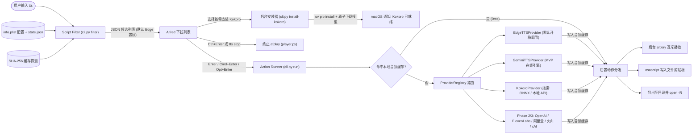

# Alfred 多引擎 TTS Workflow 开发计划

## Goal Description

构建一个基于 **Alfred 5 + Python (`uv`)** 的模块化、可扩展语音合成 Workflow（`alfred-tts-workflow`）。用户在 Alfred 中输入 `tts <text>`（或对任意应用内选中的文本触发 Universal Action）即可输出对应音频，核心在于通过统一的插件化架构无缝调度本地与云端多类 TTS 引擎。

定稿核心决策：
1. **轻量开箱即用，默认引擎设为 `Edge TTS`**：首次初始化仅安装极轻量核心依赖（耗时约 2~3 秒，`<30MB`），无需配置任何 API Key 或下载大体积模型即可立即使用 `tts <text>` 朗读中英文。
2. **Kokoro 本地引擎采用“按需懒加载安装”机制**：不在初始安装时捆绑或强制下载 `kokoro-onnx` 推理依赖及模型文件。仅当用户在 `tts-set` 中选择启用 Kokoro 或输入 `tts @kokoro <text>` 时，才引导一键后台安装（可选标准版 `~380MB` 或 INT8 量化版 `~140MB`，同时支持直连已有的本地常驻 API 服务免下载使用，并支持随时一键清理模型释放空间）。
3. **Phase 1 首个在线引擎锁定 `Google Gemini TTS`**：集成最新 `google-genai` Interactions API，默认使用低延迟的 `gemini-3.8-flash-lite-tts`（可切换至高表现力 `gemini-3.8-flash-tts`）。
4. **完整修饰键动作与全局 Universal Action**：
   - `↩ Enter`：后台直接朗读播放（自动终止上一段未播完语音，避免重音）。
   - `⌘ + ↩`：合成并将**音频文件本身**写入 macOS 剪贴板（可直接 `⌘+V` 粘贴进微信、Telegram、剪辑软件或 Finder）。
   - `⌥ + ↩`：保存到导出目录并在 Finder 中高亮显示。
   - `⌃ + ↩`（或输入 `tts stop`）：立即停止当前朗读。
   - 内置 `Speak with Alfred TTS` **Universal Action**，选中任意应用文本即可快速朗读。

---

## User Review Required

> [!IMPORTANT]
> **防误触计费与极速响应机制**：Alfred 的 Script Filter 在每输入一个字符时都会触发脚本。本方案严格执行**“列表阶段零合成、敲下回车才调用”**——输入过程中仅做参数解析、已就绪引擎排序与本地 SHA-256 缓存文件探测（响应 `<25ms`），绝不会在打字过程中触发云端 API 计费或本地模型加载。

关于存储隔离、按需下载与网络分流的工程规范如下：
- **外部化数据与原子化下载**：运行虚拟环境（`.venv`）、动态状态（`state.json`）及按需下载的 Kokoro 模型均位于 `$alfred_workflow_data`，音频缓存位于 `$alfred_workflow_cache`。模型下载采用 `.part` 临时文件校验后原子重命名，防止网络中断导致半截损坏文件残留；导出的 `.alfredworkflow` 安装包体积保持在 `<500KB`。
- **智能候选列表降噪**：日常输入 `tts <text>` 时，下拉列表仅展示**当前已就绪**的引擎（如开箱即用的 `Edge TTS`、已填入 Key 的 `Gemini TTS`、已安装模型或已连上本地 API 的 `Kokoro`）。未安装/未配 Key 的引擎不会干扰日常列表，但可通过 `@kokoro` / `@gemini` 显式唤起配置或按需安装引导。

> [!NOTE]
> **国内外网络代理自动分流**：Alfred 配置面板提供可选的 `PROXY_URL`（如 `http://127.0.0.1:7890`）。海外服务（Gemini，及后续 OpenAI / ElevenLabs / xAI）在配置后自动走代理；本地回环地址（`127.0.0.1` Kokoro API）及后续国内云服务（阿里云、火山引擎）强制直连绕过代理。

---

## System Architecture & Provider Roadmap

### 1. 整体交互与按需加载流图



### 2. 全景 Provider 技术规格与分阶段路线图

| 阶段                | Provider 标识  | 引擎名称                  | 安装与就绪策略                            | 推荐模型 / 默认音色                                                           | 输出格式          | 核心技术要点                                                                                 |
| :---------------- | :----------- | :-------------------- | :--------------------------------- | :-------------------------------------------------------------------- | :------------ | :------------------------------------------------------------------------------------- |
| **Phase 1 (MVP)** | `edge`       | **Edge TTS（默认）**      | 核心内置，免 Key 零配置开箱即用                 | 中 `zh-CN-XiaoxiaoNeural` / 英 `en-US-AriaNeural`                       | `mp3`         | `edge-tts` 异步流式合成，按文本是否含中文字符自动匹配默认中英音色                                                 |
| **Phase 1 (MVP)** | `gemini`     | **Google Gemini TTS** | 核心内置 SDK，填入 `GEMINI_API_KEY` 即激活   | `gemini-3.8-flash-lite-tts` / `gemini-3.8-flash-tts` (`Kore`, `Puck`) | `wav`         | 基于 `google-genai >= 2.30.1` `interactions.create`，支持 `speech_metadata.style` 语气控制与行内标签 |
| **Phase 1 (MVP)** | `kokoro`     | **Kokoro 本地双模**       | **按需可选安装**（或直连本地 API 免下载）          | `kokoro-v1.1-zh`（中英双语 `zf_xiaoyi` / `af_heart`）                       | `wav`         | `auto` 模式优先探测本地 `/v1/audio/speech`（`<150ms` 零冷启动）；本地 ONNX 模式由用户触发后一键安装依赖与模型            |
| **Phase 2**       | `openai`     | OpenAI Audio          | 填入 `OPENAI_API_KEY` 即激活            | `gpt-4o-mini-tts` (`coral`, `alloy`, `nova`)                          | `mp3` / `wav` | `httpx` 直调 `/v1/audio/speech`，支持 `instructions` 语气参数与自定义 `OPENAI_BASE_URL`             |
| **Phase 2**       | `elevenlabs` | ElevenLabs            | 填入 `ELEVENLABS_API_KEY` 即激活        | `eleven_flash_v2_5` / `eleven_multilingual_v2`                        | `mp3`         | `POST /v1/text-to-speech/{voice_id}`，高拟真跨语种音色                                          |
| **Phase 2**       | `aliyun`     | 阿里云百炼 (CosyVoice)     | 填入 `DASHSCOPE_API_KEY` 即激活         | `cosyvoice-v3.5-flash` (`longmiao`)                                   | `mp3`         | DashScope REST/SSE 接口，国内低延迟直连                                                          |
| **Phase 3**       | `volcengine` | 火山引擎 (豆包语音)           | 填入 `VOLC_APPID` + `VOLC_TOKEN` 即激活 | 豆包大模型音色 (`ICL_zh_female_*`)                                           | `mp3`         | `openspeech.bytedance.com` HTTP/SSE 接口，中文情感与方言表现突出                                     |
| **Phase 3**       | `xai`        | xAI Grok Voice        | 填入 `XAI_API_KEY` 即激活               | `eve`, `ara`, `leo`, `rex`                                            | `mp3` / `wav` | `wss://api.x.ai/v1/tts` 或兼容端点，支持 `[pause]`、`<whisper>` 标签                              |

---

## Proposed Changes

所有代码在仓库根目录下创建，采用清晰的 `src/alfred_tts` 包结构与 `workflow/` 资源目录分离设计。

### 组件一：项目工程化与可选依赖拆分

#### [NEW] pyproject.toml
使用 `uv` 定义轻量核心环境与 `kokoro` 可选扩展组，确保默认安装极速完成：

```toml
[project]
name = "alfred-tts-workflow"
version = "0.1.0"
description = "Multi-provider TTS workflow for Alfred 5"
requires-python = ">=3.11"
dependencies = [
    "httpx[socks]>=0.28.0",
    "edge-tts>=7.0.0",
    "google-genai>=2.30.1",
]

[project.optional-dependencies]
kokoro = [
    "kokoro-onnx>=0.4.0",
    "misaki[zh]>=0.8.0",
    "soundfile>=0.13.0",
]
dev = [
    "pytest>=8.3.0",
    "pytest-asyncio>=0.25.0",
    "ruff>=0.9.0",
]
```

#### [NEW] Makefile
包含 `dev-setup`（开发虚拟环境准备）、`lint`（`ruff` 静态检查）、`test`（运行 `pytest`）、`build`（打包生成 `dist/Alfred-TTS.alfredworkflow` 压缩包并校验 `info.plist`）。

---

### 组件二：核心调度、缓存、播放与按需安装器 (`src/alfred_tts/`)

#### [NEW] models.py
定义请求/响应数据类（`SynthesizeRequest`、`SynthesizeResult`）、动作枚举（`play` / `copy_file` / `save` / `stop`）及 Alfred Script Filter JSON 序列化结构（`AlfredItem`、`AlfredModifier`、`AlfredResponse`）。

#### [NEW] config.py
管理环境变量与持久化状态：
- 默认值：`DEFAULT_PROVIDER = "edge"`，`EXPORT_DIR = "~/Downloads/Alfred-TTS"`，`KOKORO_MODE = "auto"`，`KOKORO_API_BASE = "http://127.0.0.1:8880/v1"`，`GEMINI_MODEL = "gemini-3.8-flash-lite-tts"`。
- 动态覆盖层：读写 `$alfred_workflow_data/state.json`，记录用户通过 `tts-set` 实时切换的默认引擎、各引擎当前选中音色，以及 Kokoro 已安装的模型变体（`fp32` 或 `int8`）。

#### [NEW] cache.py
实现确定性音频缓存管理：
- 计算 `SHA-256(provider, model, voice, speed, style, text.strip())` 生成缓存文件名，保存在 `$alfred_workflow_cache/audio/`。
- 提供 `lookup()`（O(1) 判断命中并返回路径，供 Script Filter 标记 `⚡ 已缓存`）与 `store()`（写入音频并维护最多 200 条的 LRU/FIFO 清理策略）。

#### [NEW] player.py
实现 macOS 音频播放、剪贴板与通知能力：
- `play_audio(path)`：先调用 `stop_playback()` 清理 `$alfred_workflow_cache/player.pid` 记录的旧 `afplay` 进程，再以后台独立会话启动 `/usr/bin/afplay`，确保快速连续触发时干净切换。
- `copy_audio_file_to_clipboard(path, label_text)`：生成带可读摘要文件名的临时文件副本，通过 `/usr/bin/osascript` 执行 `set the clipboard to (POSIX file "...")`，使微信、Telegram、Finder 等可直接粘贴音频文件。
- `save_and_reveal(path, export_dir, provider, text)`：按时间戳与文本摘要命名导出文件，并调用 `/usr/bin/open -R` 在 Finder 中高亮定位。
- `notify(title, message)`：封装原生通知反馈合成异常或后台下载进度。

#### [NEW] installer.py
专门负责核心环境初始化与 **Kokoro 按需安装/卸载**：
- `setup_core_venv()`：调用 `uv venv` 与 `uv pip install` 仅安装轻量核心包（`httpx`、`edge-tts`、`google-genai`），数秒内完成。
- `install_kokoro(variant="fp32" | "int8")`：
  1. 发送系统通知提示后台安装开始；
  2. 在 Workflow 专属 `.venv` 中执行 `uv pip install kokoro-onnx "misaki[zh]" soundfile`；
  3. 从 `thewh1teagle/kokoro-onnx` 官方 Release（`model-files-v1.1`）流式下载对应模型文件（`kokoro-v1.1-zh.onnx` 或 `kokoro-v1.1-zh.int8.onnx`）与音色库 `voices-v1.1-zh.bin` 至 `$alfred_workflow_data/models/`（先写 `.part` 再原子替换）；
  4. 更新 `state.json` 并发送完成通知。
- `remove_kokoro_models()`：一键删除 `$alfred_workflow_data/models/` 下的模型文件以释放磁盘空间。

#### [NEW] cli.py
统一命令行入口，承载全部 Alfred 交互子命令：
- `filter <query>`：解析 `tts <text>`、`tts @<provider> <text>`、`tts stop`：
  - 若核心 `.venv` 未就绪（由 `bootstrap.sh` 检测），展示“⚡ 首次运行：回车 3 秒完成初始化”。
  - 若用户输入 `tts @kokoro <text>` 且本地既无常驻 API 也未下载 ONNX 模型，直接展示**两项按需安装卡片**（标准版 FP32 `~380MB` / 轻量版 INT8 `~140MB`），回车即可触发后台下载安装。
  - 正常合成列表设置 `"skipknowledge": true`，将当前默认引擎固定排在第一位，其余已就绪引擎依次排列。
- `run`：执行缓存查找 → 调用对应 `TTSProvider.synthesize()` → 分发 `play` / `copy_file` / `save` / `stop` 动作。
- `config-filter <query>` & `config-act`：支撑 `tts-set` 命令，支持：
  - 一键切换默认引擎（`Edge TTS` / `Gemini TTS` / `Kokoro`）；
  - 切换各引擎预设音色（如 Edge 的晓晓/云希/Aria，Gemini 的 Kore/Puck/Aoede/Charon，Kokoro 的 `zf_xiaoyi`/`zm_yunyang`/`af_heart`）；
  - 按需安装或一键清理 Kokoro 本地模型。

---

### 组件三：MVP 三大引擎插件 (`src/alfred_tts/providers/`)

#### [NEW] base.py & \_\_init\_\_.py
定义 `TTSProvider` 抽象基类（含 `is_ready()`、`setup_hint()`、`default_voice()`、`preset_voices()`、`synthesize()`）与 `ProviderRegistry` 注册中心，后续 Phase 2/3 新增任意服务商仅需在 `providers/` 下新增单文件并注册。

#### [NEW] edge.py
**默认本地/免配引擎** `EdgeTTSProvider`：
- 零配置始终 `is_ready() == True`。
- 自动语种适配：未手动锁定音色时，含中文字符用 `zh-CN-XiaoxiaoNeural`，纯英文用 `en-US-AriaNeural`，内置多款常用中英男女声音色供 `tts-set` 切换。

#### [NEW] gemini.py
**Phase 1 在线引擎** `GeminiTTSProvider`：
- 检查 `GEMINI_API_KEY` 是否非空决定 `is_ready()`。
- 若配置了 `PROXY_URL`，通过 `httpx` 客户端参数注入代理，不影响本地与国内请求。
- 使用 `google-genai` 的 `client.interactions.create` 调用 `gemini-3.8-flash-lite-tts`（默认）或 `gemini-3.8-flash-tts`，支持通过 `GEMINI_STYLE`（如 `"natural and clear"`）附加 `speech_metadata` 风格注解，直接解码默认返回的 `audio/wav` 数据。

#### [NEW] kokoro.py
**按需可选本地双模引擎** `KokoroProvider`：
- **本地 API 探测路径**（无需安装 `kokoro-onnx` 包或模型文件）：在 `api` 或 `auto` 模式下，以极短超时（`100ms`）探测 `KOKORO_API_BASE`；若本地运行了 `Kokoro-FastAPI` 或 `mlx-audio`，直接通过 `POST /audio/speech` 合成返回。
- **本地 ONNX 路径**（按需安装后激活）：惰性导入（lazy import）`kokoro_onnx`、`misaki.zh` 与 `soundfile`（保证未安装时主程序导入零报错）；中文及中英混排自动经 `ZHG2P(version="1.1")` 音素化后合成 WAV。

---

### 组件四：Alfred 5 Workflow 编排与图标资源 (`workflow/`)

#### [NEW] info.plist
包含完整的节点拓扑与 `userconfigurationconfig` 配置面板：
- **输入触发器**：
  1. `tts`（Script Filter：主入口，绑定 `↩` 播放、`⌘↩` 复制音频文件、`⌥↩` 保存定位、`⌃↩` 停止播放）；
  2. `tts-set`（Script Filter：切换默认引擎、切换音色、按需安装/清理 Kokoro 模型、清空音频缓存）；
  3. `tts-setup`（Keyword：手动触发环境修复/更新）；
  4. `Speak with Alfred TTS`（Universal Action：限定 `Text` 类型输入，连接至直接朗读动作，选中任何软件里的文字即可用当前默认引擎发声）。
- **可视化配置项（`userconfigurationconfig`）**：
  - `DEFAULT_PROVIDER`（下拉框：默认 `edge`，可选 `gemini`、`kokoro`）
  - `EXPORT_DIR`（文件夹选择器：默认 `~/Downloads/Alfred-TTS`）
  - `PROXY_URL`（文本框：可选海外代理地址）
  - `GEMINI_API_KEY`（密码框）、`GEMINI_MODEL`（下拉框：`gemini-3.8-flash-lite-tts` / `gemini-3.8-flash-tts`）、`GEMINI_STYLE`（文本框：可选默认语气风格）
  - `KOKORO_MODE`（下拉框：`auto` / `onnx` / `api`）、`KOKORO_API_BASE`（文本框：默认 `http://127.0.0.1:8880/v1`）

#### [NEW] scripts/bootstrap.sh & icons/
- `bootstrap.sh`：注入 `$HOME/.local/bin:/opt/homebrew/bin:/usr/local/bin` 至 `PATH`，优先直调 `$alfred_workflow_data/.venv/bin/python` 以确保每次按键毫秒级响应；首次未建环境时在 `filter` 模式直接输出 JSON 引导卡片。
- `icons/`：生成简洁清晰的 Workflow 主图标及 `edge`、`gemini`、`kokoro` 区分图标，提升下拉列表辨识度。

---

## Verification Plan

### Automated Tests
代码完成后执行以下自动化校验命令：

```bash
# 1. 初始化开发依赖并执行静态检查
uv sync --extra dev
uv run ruff check src/ tests/

# 2. 执行完整单元测试（覆盖参数解析、@provider 过滤、未安装 Kokoro 时的按需引导卡片、缓存读写、播放器 PID 互斥、Gemini/Edge/Kokoro API Mock）
uv run pytest -v tests/

# 3. 真实端到端冒烟验证（使用默认 Edge TTS 合成真实 MP3 并校验音频非空及文件头合法）
alfred_workflow_data="/tmp/alfred-tts-smoke/data" \
alfred_workflow_cache="/tmp/alfred-tts-smoke/cache" \
uv run python -m alfred_tts.cli filter "你好，欢迎使用 Alfred TTS"

# 4. 构建 .alfredworkflow 产包并校验 info.plist XML 语法
make build && plutil -lint workflow/info.plist
```

### Manual Verification
1. **零门槛开箱体验验证**：双击导入 `dist/Alfred-TTS.alfredworkflow`，不填任何 API Key、不下载 Kokoro，直接输入 `tts 你好，今天天气真好` 回车，验证自动完成 2~3 秒轻量初始化并由默认 `Edge TTS` 清晰朗读。
2. **Universal Action 验证**：在浏览器或编辑器中选中一段文字，按下 Alfred Universal Action 快捷键并选择 `Speak with Alfred TTS`，验证立即以默认引擎朗读选中文本。
3. **Gemini 在线引擎验证**：在 Workflow 配置面板填入 `GEMINI_API_KEY`，输入 `tts 你好` 验证列表中出现 `Gemini TTS` 候选项（或通过 `tts-set` 将 Gemini 设为默认），回车验证云端合成与二次缓存瞬时播放。
4. **Kokoro 按需懒加载与卸载验证**：输入 `tts @kokoro 测试离线语音`（或在 `tts-set` 中选择安装 Kokoro），验证弹出按需下载引导项；回车下载完成后验证离线中英混读正常，且可通过 `tts-set` 一键清理模型文件。
5. **修饰键剪贴板与导出验证**：分别测试 `⌘+↩`（粘贴音频文件到聊天窗口/Finder）、`⌥+↩`（打开 Finder 高亮保存文件）及 `⌃+↩`（立即中断播放）。
